<picture>
  <source media="(prefers-color-scheme: dark)" srcset="./assets/header-dark.svg">
  <source media="(prefers-color-scheme: light)" srcset="./assets/header-light.svg">
  
</picture>

 

I build products end to end: interfaces in **React, React Native and Flutter**, services in **Java and Spring Boot**. Most of my 2026 goes into wiring AI agents into real codebases. That means giving them context, guardrails and a CI loop, so their work lands as a merge request a human can review.

### What I'm working on

- **Coding agents in repos and CI.** Context, tools, evals and quality gates for agents working in a large frontend monorepo.
- **Code generation.** Pipelines that turn specs and designs into typed, tested code.
- **Scalable frontend.** TypeScript architecture and i18n for multi-package web and mobile apps.

### Stack

|                    |                                                                                     |
| :----------------- | :---------------------------------------------------------------------------------- |
| **Frontend**       | TypeScript · React 19 · Next.js · Vite                                              |
| **Mobile**         | React Native (New Architecture, Expo) · Flutter / Dart                              |
| **Backend**        | Java · Spring Boot · Node.js · PostgreSQL · Redis                                   |
| **AI engineering** | Claude Code & Agent SDK · MCP servers · OpenAI / Anthropic APIs · Vercel AI SDK · RAG · evals |
| **Automation**     | Python · n8n · GitLab CI · GitHub Actions · Docker                                  |

### Elsewhere

[LinkedIn](https://linkedin.com/in/artemkhairov) &nbsp;·&nbsp; [GitHub](https://github.com/artemkhairov)
